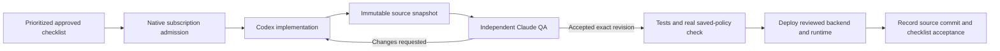

# Orwell subscription agent pilot, October 15, 2026

## Verified delivery

Claude Code and Codex are authenticated on Hostinger using Eric's existing subscriptions. The controller has delivered the real Orwell checklist step `lead-orchestration-accountability/qa` through implementation, independent Claude review, a request for changes, Codex Sol repair, independent re-review, deterministic checks and production deployment. The budget step was subsequently independently reviewed and accepted under the new production guards. Other pilot checks remain individually queued until their own evidence and reviews succeed.

The delivered product revision is `sha256:f1123d9742a37f1ea0c041de98dbdff3b60fc5df933454de7f36ee9ed73bb791`.

- Actual repaired author: Codex `gpt-6.1-sol`, low effort, session `01a141f2-322b-7512-8948-454acf7334f7`.
- Independent accepted reviewer: Claude session `9bfc5dfa-07e4-4730-82cd-f853fd91989d`.
- Earlier independent request for changes: Claude session `4425ad14-b022-41c0-afa3-1eafa5d56bb2`.
- Production backend: `https://fleet-vole-527.convex.cloud`.
- User-visible authoritative task record: `https://orwell-panama.vercel.app/scoreboard`.

## Budget contract

The original allocation is unchanged: at most 30 additional weekly percentage points per provider, with three points reserved. The Codex baseline is 22% used. Claude's measured baseline is 0% weekly. Other account activity counts conservatively against the same allowance. No API fallback or automatic increase to 50% is authorized.

The original pilot runs from October 15 at 3:50:25 p.m. Detroit time to October 16 at 3:50:25 p.m. Native usage is checked before every model launch and every 45 seconds during a run. Missing or invalid usage stops work. A real weekly reset never renews the allocation. Expired short session windows can be reconciled and recorded while every original weekly baseline is retained.

Additional finite bounds: one model at a time; eight minutes per model turn; 32 model runs; 12 since an actual acceptance; secondary ceilings of 15 million reported/observed tokens and 1 million fresh tokens. Cached input is recorded separately. A model-spending ceiling still allows already reviewed non-model acceptance. Budget and deadline stops appear in the shared scoreboard pause reason, and a user pause is preserved.

These are admission and termination controls, not a provider-enforced hard quota. Native meters can lag and an in-flight request can overshoot. The three-point reserve and bounded turns provide headroom. Token counts and CLI list-price estimates do not establish subscription dollars charged.

## Host and trust boundaries

Hostinger: `srv1352816`, existing Orwell user uid/gid 1001. Native CLIs are under `/home/orwell/agent-tools/`. Builds are under `/home/orwell/build/`. Root-owned controller code is under `/opt/orwell-agent-controller/`; private policy, receipts and deployment evidence are under `/var/lib/orwell-agent-controller/`. The queue credential is root-only in `/etc/orwell-agent-controller/`; model children cannot read it and receive no deployment credentials or API-key fallback environment.

`orwell-agent-controller.timer` schedules work without model calls when idle. The root control plane launches model processes as the unprivileged Orwell user. Systemd limits writable paths, memory, CPU and process count. The VPS cannot run the CLI's inner bubblewrap network sandbox; the worker uses the service's OS restrictions instead. QA source copies are root-owned, readable and immutable to the model UID, with an access check before paying for a review.

Existing monitor, scraper, news and backfill services remain active. The read-only observer remains enabled. Existing OpenClaw was not used for inference or repurposed. The separate Qwen3.5 4B Ollama service remains loopback-only and resource-limited. Its earlier routing benchmark passed 5/6 and did not qualify it for coding or final QA. Idle detection, queue decisions, acceptance and budget checks stay in code.

## Concrete defects and repairs

The first live worker correctly failed when the VPS sandbox blocked commands. The first Claude review correctly withheld approval when snapshot traversal permissions were wrong. Both infrastructure issues were repaired internally.

A later Claude approval missed a saved-policy edge case. The baseline probe completed one millisecond before policy initialization, and the candidate rejected that legitimate baseline. The premature checklist acceptance was explicitly revoked in the production audit trail. A real original-policy gate and regression now cover the boundary. No replacement weekly baseline was created.

The proposed identity guard also confused old roster profiles with actual CLI sessions. A production-contract regression reproduced the failure. The repair validates fresh actual run records bound to separate stable identities, accepts legitimately completed model turns, and leaves historical roster bindings untouched.

The native Claude API populated `seven_day_breakdown`, which is metadata rather than another allowance. The guard interrupted a review when the earlier parser treated it as a malformed window. The parser was repaired. That interrupted session, `3587f5b8-24e5-49e8-af87-d1831ce323db`, has 213,596 observed transcript tokens as a lower bound; its exact final total remains unknown. Fresh native account quota reconciled continued eligibility against the original allocation. The missing total and absent verdict were never invented. A later review actually ran and requested changes.

Production guards reject self-review, same-provider review, stale revisions, missing actual sessions, expired leases, contradictory result replays and smoke-pause bypasses. Result replay is idempotent. Every newly checked step retains separate author/reviewer evidence.

## Evidence and source

Source: `scripts/orwell-pilot/`, `convex/dispatch.ts`, `convex/scoreboard.ts`, runtime schema and scoped regression scripts. The legacy Mac dispatcher is retired for model execution so it cannot bypass the VPS admission path.

Evidence: `/Users/ericnunlee/Documents/Codex/2026-10-15/agent-team-video-review/pilot-qa/vps-live/`. Native receipts preserve actual providers, model names, sessions, usage, revisions and outcomes. The video synthesis remains in the parent research folder.

Git release bookkeeping is being connected before continuing the remaining pilot checks. It records a task-to-file checklist, preserves unrelated work, skips unreleased source, and retains reviewed runtime changes without pushing or adding credentials. The broader Orwell backlog is preserved; completing this pilot does not imply every application request is finished.

### Acceptance repair submission — 2026-10-16

The candidate caller now checkpoints the exact `controller:<leaseId>` acceptance identity before deterministic verification. It saves command names, actual exit codes and output in `checks-<leaseId>.json`, and saves the actual deployment exit code, URL, revision and lease in `deployment.json`. `acceptance-proof.mjs` reads those records back and hashes their actual bytes. The internal finish contract requires those hashes, the same item/lease/revision, and all six successful checks (pilot, live-contract, acceptance, pause, typecheck, original-policy). Arbitrary marker prose cannot finalize a checklist. The backend records proof hashes alongside completion. These are trusted controller attestations; public callers cannot write them, and the backend does not independently read VPS files.

`affinity.json` persists the shared workspace owner through triage, work, review rejection, repairs, retries and blocked states. Only acceptance or explicit supersession releases ownership; missing owners hold visibly. The acceptance repair gates every other candidate. A conflicting preexisting owner holds both rather than silently publishing it or discarding its work. Selection regressions exercise these transitions and model-only spending holds. Empty preflight directories remain uncounted; corrupt/interrupted execution markers remain spending holds.

The secondary finite ceiling is 32 runs to include recorded setup/recovery overhead. This does not renew or increase the original 30 percentage-point weekly allocation, 3-point reserve, 24-hour deadline, 12 runs since acceptance, 15M reported/observed token ceiling or 1M fresh-token ceiling.

Read-only production observation used `/opt/orwell-evidence/runtime.json` and its public `dispatch:snapshot` query example at `https://fleet-vole-527.convex.cloud/api/query`. The accepted `lead-orchestration-accountability/qa` event is at 1792108042660; submitted author session `01a141f2-322b-7512-8948-454acf7334f7` and accepted reviewer session `9bfc5dfa-07e4-4730-82cd-f853fd91989d` have matching published revision `sha256:f1123d9742a37f1ea0c041de98dbdff3b60fc5df933454de7f36ee9ed73bb791`. The latest published deployment instead belongs to the later budget item at revision `sha256:111acd96a504d367938b1ae72c43aad83aa9b8b4c30e4e31e1e9c484a0569aed`; this is not evidence that this repair has deployed. Saved real-session regressions reopen `/opt/orwell-evidence/session-contract.json` without rewriting historical profiles.

Submission verification (implementation evidence, not independent acceptance):

- Pending independent QA of the exact submitted source revision.
- Pending controller deployment, commit, and live acceptance under the repaired contract.
- Historical accepted-event inspection is read-only; no prior acceptance or source record was rewritten.

The worker ran all pilot tests, dispatch acceptance/live-contract/pause harnesses, the Convex typecheck and controller syntax check. Only the controller may perform activation and checklist completion. A candidate/installed source difference before that handoff is expected.
